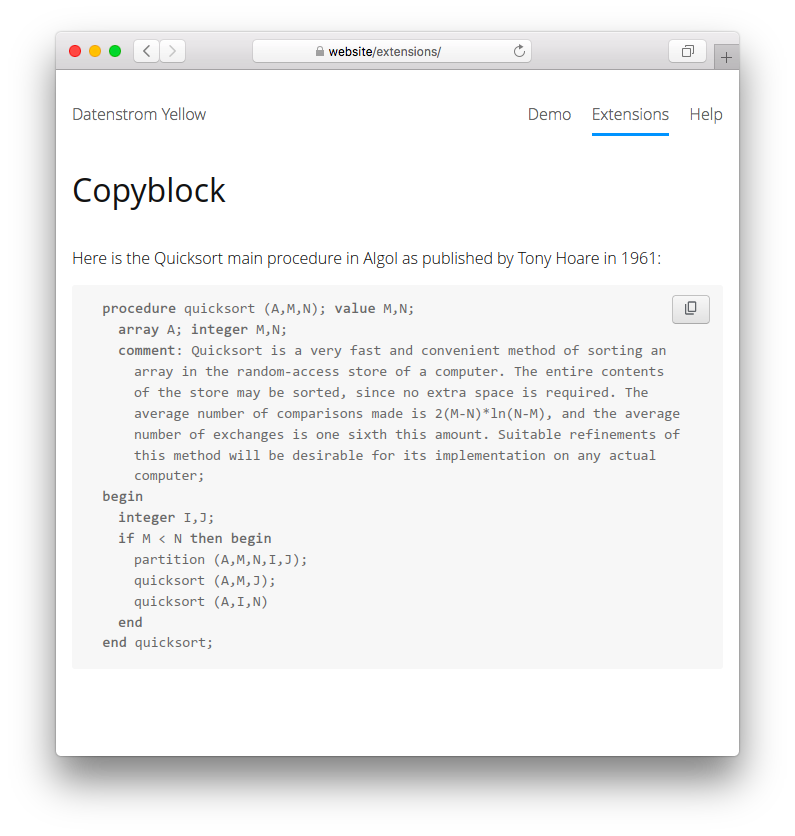

# Copyblock 1.0.0

Copy special blocks to clipboard. Developed by Giovanni Salmeri.

## How to install an extension

[Download ZIP file](https://github.com/GiovanniSalmeri/yellow-copyblock/archive/refs/heads/main.zip) and copy it into your `system/extensions` folder. [Learn more about extensions](https://github.com/annaesvensson/yellow-update).

## How to copy a special block

This extension creates a "copy" button beside each special block in a page (code, music, math, charts). Click the button to copy the source to your clipboard.

## Acknowledgements

The extension is derived from [Copycode](https://github.com/schulle4u/yellow-copycode) by Steffen Schultz. Thank you for the good work.

Do you have questions? [Get help](https://datenstrom.se/yellow/help/).
